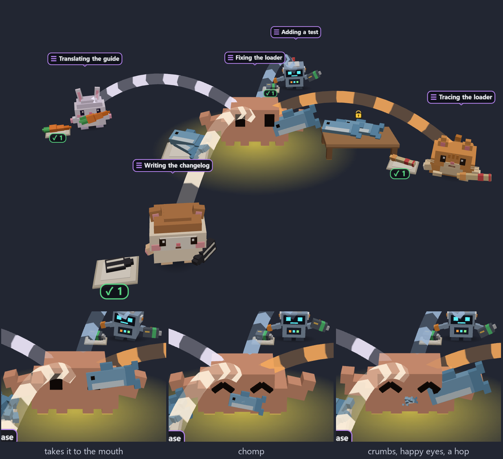

<div align="center">

# 🦀 crew-graph

**Claude Code 에이전트가 일하는 모습을 작은 3D 캐릭터로 — 바탕화면, 터미널, 브라우저에서.**

[](plugins/crew-graph/.claude-plugin/plugin.json) [](https://claude.com/claude-code) [](LICENSE) [](#-로컬에서만-동작)

[English](README.md) · **한국어**


</div>

## ⚡ 바로 시작

```text
/plugin marketplace add JSungMin/crew-graph
/plugin install crew-graph@crew-graph
/reload-plugins
/crew pet
```

처음 `/crew pet`을 실행하면 Electron(약 100 MB)을 한 번만 백그라운드로 설치하고, 끝나면 펫이 뜹니다.
`/crew pet`과 `/crew 3d`는 `PATH`에 Node.js가 있어야 합니다(`/crew 3d`는 22 이상). [Flightdeck](https://github.com/scasella/claude-flightdeck)을 쓰고 있다면 꺼 주세요. crew-graph에 전부 들어 있습니다.

## 👀 보는 방법 네 가지

| | 명령 | 보이는 것 |
| --- | --- | --- |
| 🖥️ **데스크톱 펫** | `/crew pet` | 세션마다 뜨는 투명하고 항상 위에 있는 창. 에이전트마다 캐릭터가 하는 일을 몸으로 보여 주고, 다룬 파일이 옆에 떠 있습니다. |
| 📟 **터미널 패널** | `/crew` | 대시보드: 에이전트 트리, 손댄 계획·문서, 비용, 컨텍스트, 권한 검사, 로그. |
| 🌐 **브라우저** | `/crew web` | 세션 상태와 실시간 이벤트 로그가 붙은 전체 3D 화면. |
| 🧊 **패널 속 3D** | `/crew 3d` | 같은 3D 화면을 터미널에 블록 문자로 그립니다. |

<table>
<tr>
<td width="50%"><br><sub>세션마다 창 하나, 이름표 포함</sub></td>
<td width="50%"><br><sub>브라우저 화면</sub></td>
</tr>
</table>

## 🐾 펫과 놀기

| 이렇게 하면 | 이렇게 됩니다 |
| --- | --- |
| 캐릭터나 창을 **드래그** | 창을 들고 옮깁니다. 캐릭터가 대롱대롱 흔들립니다 |
| 든 채로 **흔들기** | 어지러워합니다: 소용돌이 눈, 별, 비틀거림 |
| 캐릭터 **클릭** | 꼬집기: 찌그러지며 폴짝 |
| **쓰다듬기**(위에서 왔다 갔다) | 행복한 눈과 하트 |
| 파일 **클릭** | 파일을 엽니다 |
| 캐릭터나 파일에 **올려 두기** | 카드: 상태와 진행, 또는 파일 요약 |
| **할 일** 지켜보기 | 할 일 하나하나가 음식입니다: 기다릴 땐 접시 위, 하는 중엔 손에, 끝나면 먹습니다. 올려 두면 카드가 뜹니다 |
| **오른쪽 클릭** | `Character ▸`, `Ask Claude…`, `Settings…`, 열기, 경로 복사 |
| 끝난 에이전트에 **오른쪽 클릭** | `Dismiss`(손을 흔들고 펑 사라집니다). 실행 중이면 `Ask Claude to stop it` |
| 휠 · Ctrl+휠 · 오른쪽 드래그 | 확대 · 크기 조절 · 회전 |

투명한 부분을 클릭하면 바탕화면으로 그대로 통과합니다.



<table>
<tr>
<td width="58%"><br><sub>흔들면 어지러워합니다</sub></td>
<td width="42%"><br><sub>Settings… : 캐릭터, 표시 항목, 움직임, 창</sub></td>
</tr>
</table>

## 🎭 캐릭터


| | Id | `auto`가 고르는 역할 |
| --- | --- | --- |
| 🦀 | `crab` (기본) | lead, main, generalist |
| 🐰 | `bunny` | docs, write, summarize, web |
| 🐱 | `cat` | explore, search, review |
| 🐹 | `mochi` | plan, architect, design |
| 🤖 | `robot` | code, build, fix, test |

펫의 **Settings…** 에서 고르거나 `characters` 옵션으로 정합니다:

```text
main=crab, Explore=cat, *=auto
```

`auto`는 에이전트의 역할에 맞는 캐릭터를 고르고, `random`은 에이전트마다 고정된 무작위 캐릭터를 줍니다. 직접 만든 캐릭터(복셀 JSON 또는 GLB)는 `~/.claude/crew-graph/characters/`에 넣으면 됩니다. 형식은 [가이드(영문)](docs/guide.md#characters)에 있습니다. 파일에 문제가 있거나 빠진 것이 있으면 캐릭터에 빨간색 또는 주황색 `!` 배지가 붙고, **Settings…** 와 `/crew characters`에 고치는 방법과 함께 나옵니다([가이드](docs/guide.md#pack-problems)).

## ⌨️ 명령

| 명령 | 하는 일 |
| --- | --- |
| `/crew` · `/crew close` · `/crew reset` | 패널 열기, 닫기, 비우기 |
| `/crew pet` · `/crew pet off [all]` | 펫 시작 · 이 창 닫기(`all`이면 펫 종료) |
| `/crew web [noopen\|off]` | 브라우저 화면 |
| `/crew 3d [off]` | 패널 속 3D |
| `/crew characters [reload]` | 캐릭터 목록과 누가 무엇을 받는지 |
| `/crew layout auto\|compact\|wide\|mini` | 패널 배치 |

옵션(`/config`): `petOnStart`, `webOnStart`, `characters`, `layout`, `panels`, 그리고 [Flightdeck 옵션 전부](docs/guide.md#configure).

## 🔒 로컬에서만 동작

- **보기만 하고 바꾸지 않습니다.** 모든 훅은 이벤트를 그대로 넘깁니다.
- **`~/.claude/crew-graph/` 아래에만 씁니다.** 그것도 `/crew web`, `/crew pet`, `/crew characters reload`를 실행한 뒤에만.
- **네트워크를 쓰지 않습니다.** three.js는 번들로 들어 있습니다. 예외는 한 번뿐인 npm Electron 설치입니다.

자세히: [What it can reach](docs/guide.md#what-it-can-reach).

## 📖 더 보기

**[가이드(영문)](docs/guide.md)** 에 나머지가 전부 있습니다: 패널별 설명, 펫 설정 파일, 캐릭터 형식, 3D 렌더러, 모드 개발 방법.

## 크레딧

MIT, [`LICENSE`](LICENSE) 참고.

- **[Flightdeck](https://github.com/scasella/claude-flightdeck)** © 2026 Stephen Casella, MIT (`third_party/flightdeck-LICENSE.txt`). crew-graph가 흡수했고, 옮겨 온 파일 머리에 표기가 있습니다.
- **three.js** © three.js authors, MIT (`plugins/crew-graph/web/THREE_LICENSE.txt`, `third_party/three-LICENSE.txt`).
- **Clawd**는 Claude Code의 마스코트입니다. 여기 크랩은 팬아트로 새로 그렸고, 다른 캐릭터는 직접 디자인했습니다.
