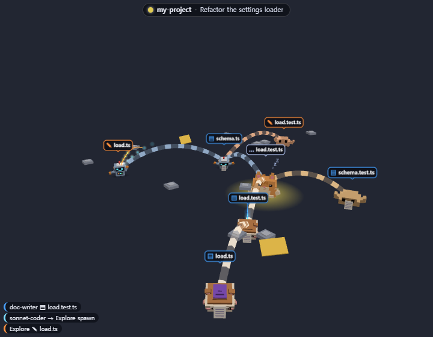
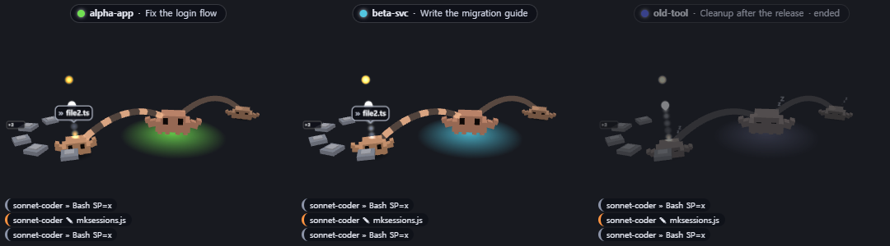
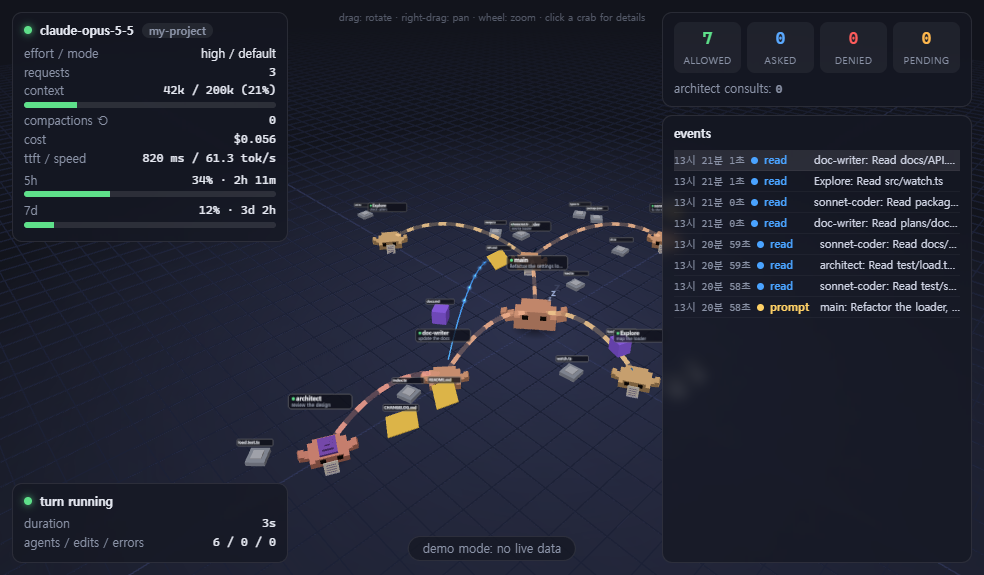
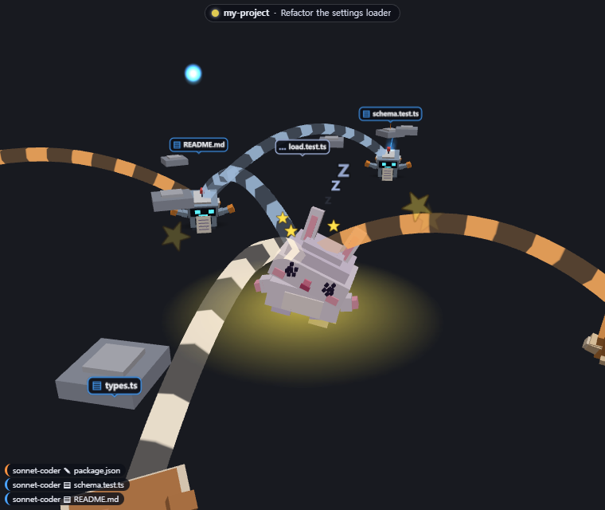
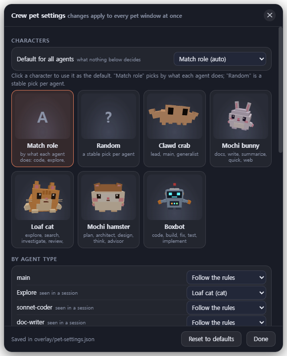
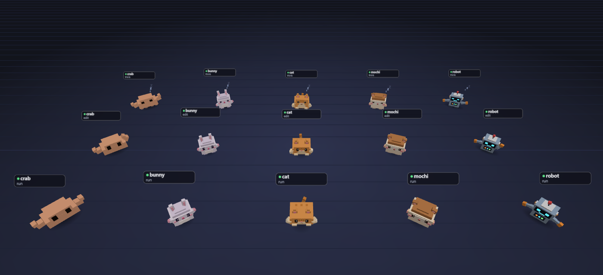

<div align="center">

# 🦀 crew-graph

**Watch your Claude Code agents work — as little 3D characters on your desktop, in your terminal or in a browser.**

[](plugins/crew-graph/.claude-plugin/plugin.json) [](https://claude.com/claude-code) [](LICENSE) [](#-local-only)

**English** · [한국어](README.ko.md)



</div>

## ⚡ Quick start

```text
/plugin marketplace add JSungMin/crew-graph
/plugin install crew-graph@crew-graph
/reload-plugins
/crew pet
```

The first `/crew pet` installs Electron (~100 MB) once, in the background, and opens the pet when it is done.
`/crew pet` and `/crew 3d` need Node.js on `PATH` (22+ for `/crew 3d`). Already using [Flightdeck](https://github.com/scasella/claude-flightdeck)? Turn it off: crew-graph includes all of it.

## 👀 Four ways to watch

| | Command | What you see |
| --- | --- | --- |
| 🖥️ **Desktop pet** | `/crew pet` | A transparent, always-on-top window per session. Each agent is a character that acts out its work; its files float beside it. |
| 📟 **Terminal pane** | `/crew` | A dashboard: the agent tree, the plans and docs they touch, cost, context, permission checks and a log. |
| 🌐 **Browser** | `/crew web` | The full 3D view with session vitals and a live event log. |
| 🧊 **3D in the pane** | `/crew 3d` | The same 3D view, drawn in the terminal with block glyphs. |

<table>
<tr>
<td width="50%"><br><sub>One window per session, each with a nameplate</sub></td>
<td width="50%"><br><sub>The browser view</sub></td>
</tr>
</table>

## 🐾 Play with the pet

| Do | It does |
| --- | --- |
| **Drag** a character or the window | Carries the window; the character dangles and swings |
| **Shake** while carrying | It gets dizzy: spiral eyes, stars, a stagger |
| **Click** a character | Pinch: it squashes and hops |
| **Stroke** it (hover back and forth) | Pet: happy eyes and hearts |
| **Click** a file | Opens it |
| **Hover** a character or a file | A card: status and steps, or a file summary |
| **Right-click** | `Character ▸`, `Settings…`, open, copy path |
| Wheel · Ctrl+wheel · right-drag | Zoom · resize · rotate |

Clicks on the transparent parts go through to your desktop.

<table>
<tr>
<td width="58%"><br><sub>Shake it: dizzy</sub></td>
<td width="42%"><br><sub>Settings… : characters, what to show, motion, window</sub></td>
</tr>
</table>

## 🎭 Characters



| | Id | Picked by `auto` for |
| --- | --- | --- |
| 🦀 | `crab` (default) | lead, main, generalist |
| 🐰 | `bunny` | docs, write, summarize, web |
| 🐱 | `cat` | explore, search, review |
| 🐹 | `mochi` | plan, architect, design |
| 🤖 | `robot` | code, build, fix, test |

Pick them in the pet's **Settings…**, or with the `characters` option:

```text
main=crab, Explore=cat, *=auto
```

`auto` matches each agent's role to a character; `random` gives each agent a stable random one. Bring your own as voxel JSON or GLB in `~/.claude/crew-graph/characters/` — see the [guide](docs/guide.md#characters).

## ⌨️ Commands

| Command | Does |
| --- | --- |
| `/crew` · `/crew close` · `/crew reset` | Open, close or clear the pane |
| `/crew pet` · `/crew pet off [all]` | Start the pet · close this window (or quit) |
| `/crew web [noopen\|off]` | The browser view |
| `/crew 3d [off]` | 3D inside the pane |
| `/crew characters [reload]` | List characters and who gets which |
| `/crew layout auto\|compact\|wide\|mini` | Pane layout |

Options (in `/config`): `petOnStart`, `webOnStart`, `characters`, `layout`, `panels` and the rest of [Flightdeck's](docs/guide.md#configure).

## 🔒 Local only

- **Watches, never changes.** Every hook passes its event on unchanged.
- **Writes only under `~/.claude/crew-graph/`**, and only after `/crew web`, `/crew pet` or `/crew characters reload`.
- **No network.** three.js is bundled. The one exception: installing Electron from npm, once.

Details: [What it can reach](docs/guide.md#what-it-can-reach).

## 📖 More

The **[guide](docs/guide.md)** has everything else: every panel, the pet's settings file, the character format, the 3D renderer, and how to develop the mod.

## Credits

MIT, see [`LICENSE`](LICENSE).

- **[Flightdeck](https://github.com/scasella/claude-flightdeck)** © 2026 Stephen Casella, MIT (`third_party/flightdeck-LICENSE.txt`). crew-graph absorbs it; the ported files carry a header note.
- **three.js** © three.js authors, MIT (`plugins/crew-graph/web/THREE_LICENSE.txt`, `third_party/three-LICENSE.txt`).
- **Clawd** is Claude Code's mascot. The crabs here are drawn from scratch as fan art; the other characters are original designs.
